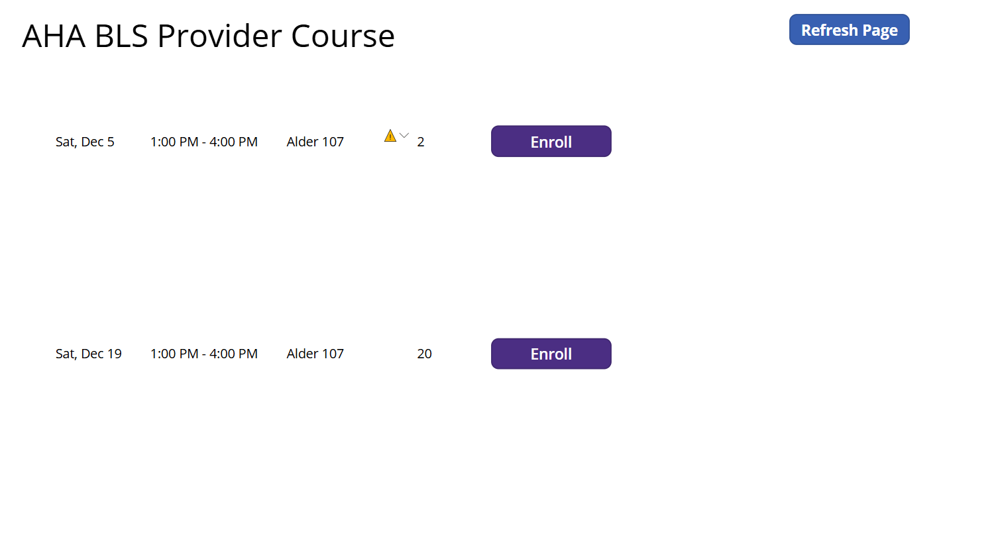
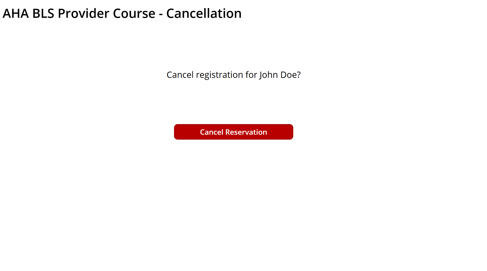

# UWEMS CPR Course Registration

Class registration for UWEMS's two CPR course offerings, AHA HeartSaver (for civilians), and AHA Basic Life Support (for healthcare providers).
Application is built on the Microsoft Power Platform.

Replaces manual Microsoft Forms + hand-sent emails with live seat counts, waitlists,
and automated emails. All data and student information stays in UW Microsoft 365.

**Stack:** Power Apps (Power Fx), SharePoint Lists, Power Automate

## Status
- [x] Phase 1: Class list with live seats remaining
- [X] Phase 2: Enrollment + waitlist
- [ ] Phase 3: Automated confirmation emails
- [ ] Phase 4: Cancellation, waitlist promotion, reminders
- [ ] Phase 5: HeartCode certificate upload + approval

## Features
- Live class list showing seats remaining; full classes switch to "Join waitlist"
- Signup form with input validation (required names, email format)
- Automatic enrollment or waitlisting based on capacity
- One active registration per person across upcoming classes
- Secure self-service cancellation via a unique per-registration link (GUID token)

## Demos

