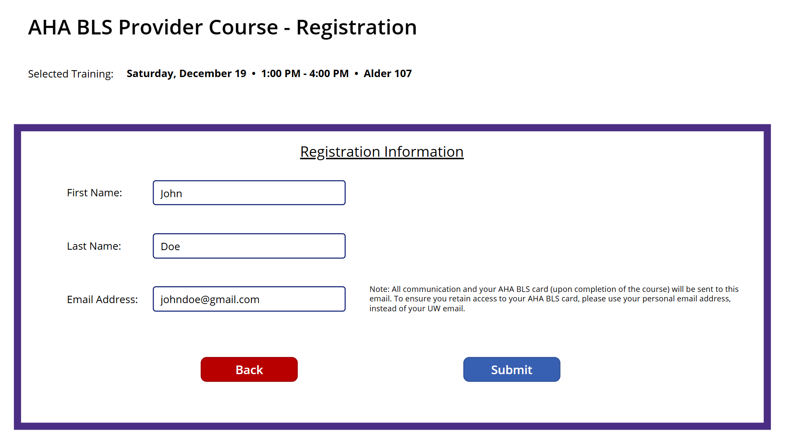
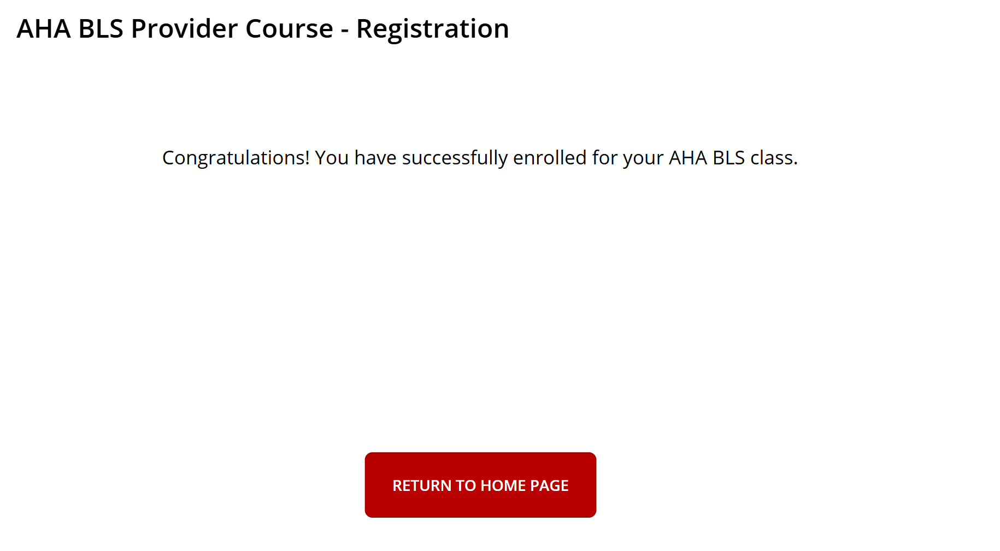

# UWEMS CPR Course Registration

Class registration for UWEMS's two CPR course offerings, AHA HeartSaver (for civilians), and AHA Basic Life Support (for healthcare providers).
Application is built on the Microsoft Power Platform.

Replaces manual Microsoft Forms + hand-sent emails with live seat counts, waitlists,
and automated emails. All data and student information stays in UW Microsoft 365.

**Stack:** Power Apps (Power Fx), SharePoint Lists, Power Automate

## Status
- [x] Phase 1: Class list with live seats remaining
- [X] Phase 2: Enrollment + waitlist
- [ ] Phase 3: Automated confirmation emails
- [ ] Phase 4: Cancellation, waitlist promotion, reminders
- [ ] Phase 5: HeartCode certificate upload + approval

## Features

- *NEW* Automated confirmation emails for enrolled vs. waitlisted registrants. Emails include individual cancellation links, as well as payment links (only for BLS courses)
- Front page now displays description of the website and UWEMS course offerings. 
- Course registration now includes both Heartsaver and AHA BLS. Course offerings are displayed side-by-side.
- Scaffold for the PowerAutomate Flow is now implemented. Allows guests to access website without requiring edit access. Used later for automated emails.
- Live class list showing seats remaining; full classes switch to "Join waitlist"
- Signup form with input validation (required names, email format)
- Automatic enrollment or waitlisting based on capacity
- One active registration per person across upcoming classes
- Secure self-service cancellation via a unique per-registration link (GUID token)

## Docs
- [Data model](docs/data-model.md)
- [Flows](docs/flows.md)

## Demos

